# 深渊幸存者 (Abyss Survivor)

> 一款用 AI 编码代理**全程驱动开发**的吸血鬼幸存者 Like —— Godot 4.6 / GDScript，约 1.4 万行代码，全部 UI 与素材管线代码构建（`.tscn` 只有一个挂脚本的空场景）。
> A Vampire-Survivors-like built end-to-end by an AI coding agent, with a headless self-test harness as its backbone.


## 下载即玩

- **[Releases](../../releases)** 下载 `abyss_survivor_win64_v1.0.zip`，解压双击 `abyss_survivor.exe`（Windows x64，免安装，约 100 MB）。
- 从源码运行：装 [Godot 4.6](https://godotengine.org/download)，编辑 `run.bat` 顶部的 Godot 路径后双击，或命令行 `godot --path .`。

## 游戏概览

| | |
|---|---|
| 玩法 | 俯视角割草生存，自动攻击，玩家只管走位；固定 **12 波**，一局约 6 分钟 |
| 角色 | 5 名（蓝帽小子/粉红壮汉/忍者蛙/面具客/只因信徒），各带起始武器与专属被动 |
| 武器 | 7 种（能量弹/旋刃/圣环/飞刀/手里剑/燃烧瓶/闪电）各 3 级，**7 条进化链**：满级武器 + 满级配对被动 → 质变 |
| 强化 | 9 类通用被动各 3 级 + 升级三选一（每局 2 次重抽）；常规池抽干后转「**超限**」无限成长，升级永不断档 |
| 敌人 | 7 种杂兵 + 6 种词缀（疾风/坚韧/再生/射手/分裂/自爆）+ 双词缀精英；第 4/8 波中 Boss，第 12 波双 Boss（终极 Boss 击杀即通关） |
| 风险系统 | 局内**诅咒值**（商店主动买，0–10 层）+ 8 条**波间事件**——加压与回报成对出现，绝不给玩家负面属性 |
| 难度 | 简单/普通/困难只作用敌人侧；敌人血/伤/密度随波次爬坡 |
| 养成 | 波间商店（本局金币）+ 局外军械库（永久金币）+ 11 项全局成就 |
| 存档 | 土豆兄弟式**单槽局内续玩**（关窗即存、读档即消费、原子写）+ 跨局永久进度 |
| 画面 | 640×360 逻辑分辨率整数 2× 放大到 1280×720，全局 Nearest 像素风 |
| 图鉴 | 5 分类「图书馆古籍」风图鉴（双页书翻页动效），数值与刷怪表**单一数据源** |

## 截图导览

> 以下截图由游戏内置的 `--ui-shot` 自检**自动生成**——同一套代码既能出图验收界面,也是本 README 的图源。全部 19 屏,这里按「菜单 → 战斗 → 成长 → 局外 → 结算」挑了 17 屏讲解。

### 主菜单与存档


- 深渊红天 + 废墟背景,五个入口(开始游戏/设置/强化商店/游戏图鉴/退出游戏)全键盘可达:`W/S` 选择、`空格/回车` 确认——每个界面的键盘链路都有 `--menu-check` 自检兜底。

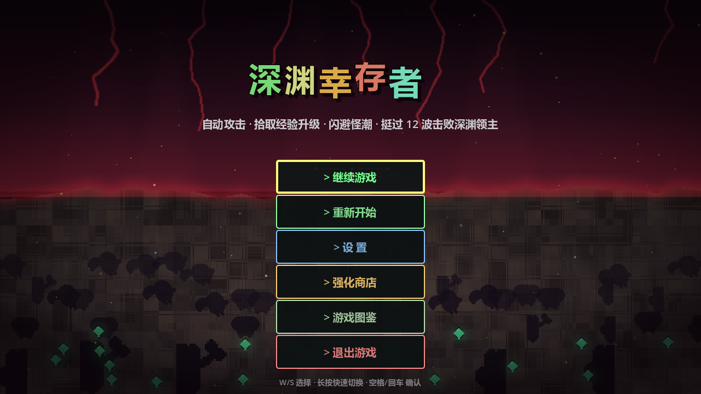

- 存在**局内续玩档**(土豆兄弟式单槽)时,首两项自动变成「继续游戏 / 重新开始」;关窗、设置里「保存并退出」都会落档,读档即消费。

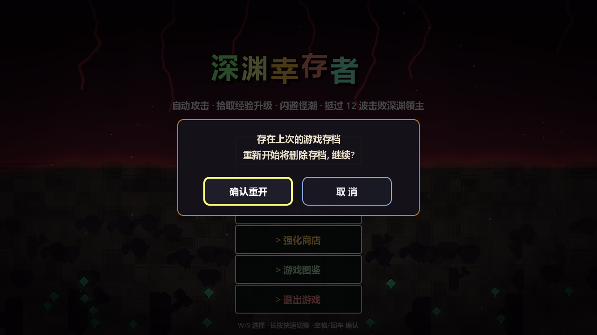

- 点「重新开始」会明示「将删除存档」的确认层——存档是不可逆资源,破坏性操作永远先问。

### 战斗 HUD


- 顶部中央 `波次 1/12 · 24s`:固定 12 波制,倒计时最后 5 秒转橙,Boss 收尾期改显「击败首领」——波次推进对玩家永远有预告。
- 大字下方的 `铁壁 · 敌血 +50% · 巨魔掉率 +15%` 是**波间事件**:每波随机一条双向扰动(压你的面与喂你的面成对出现,没有纯惩罚事件)。
- 左上「本局加成」面板汇总本局全部临时修正(`Tab` 可折叠);右上 `诅咒 3/10` 是玩家在商店**主动买入**的风险倍率——加压与回报成对,永不直接扣玩家属性。
- 底部 7 格武器栏把「未获得」也显示出来,方便规划进化链(满级武器 + 满级配对被动 → 质变进化)。

### 词缀与精英

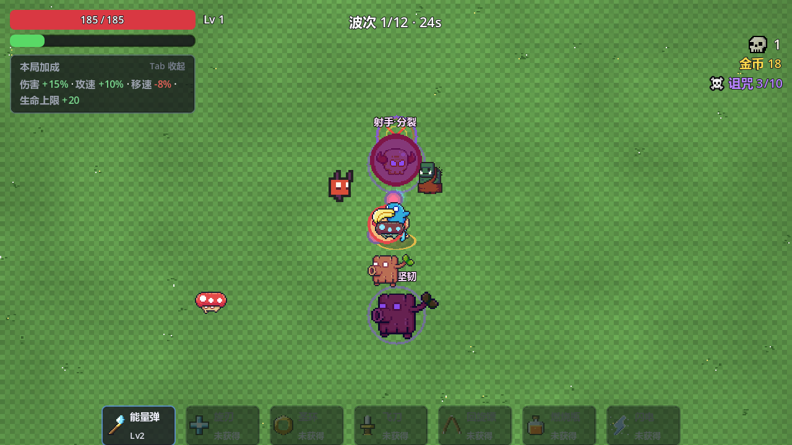

- 紫色光环 + 头顶 `射手|分裂` 标签是**双词缀精英**(血 ×2.6 / 伤 ×1.6,掉金币与宝箱);旁边无光环的 `坚韧` 是普通词缀怪。
- 6 种词缀(疾风/坚韧/再生/射手/分裂/自爆)按波次逐步解锁,精英第 4 波起才可能出现——同一只怪的组合决定这波怎么打。

### Boss 战


- 顶部 Boss 血条与 HUD 倒计时**共读单一真相源**:第 4/8 波中 Boss,第 12 波双 Boss(击杀终极即通关)。
- 设计规则:**Boss 必须打完波才推进**,DPS 不够就被它耗死,不存在"时间到 Boss 悄悄消失"的白打。

### 升级三选一


- 每张卡标稀有度档位(`精良`/`普通`)、`Lv a → b` 与特性行(如飞刀自带**中毒**);青色边框为当前选中。
- 每局 2 次**重抽**(底部按钮,用完置灰不隐藏);常规池抽干后自动切「∞ 超限」无限成长,升级永不断档。

### 武器进化视觉:燃烧瓶三段

| Lv1 单瓶 | Lv3 双瓶·白热爆裂 | 进化「炼狱燃烧瓶」 |
|---|---|---|
| 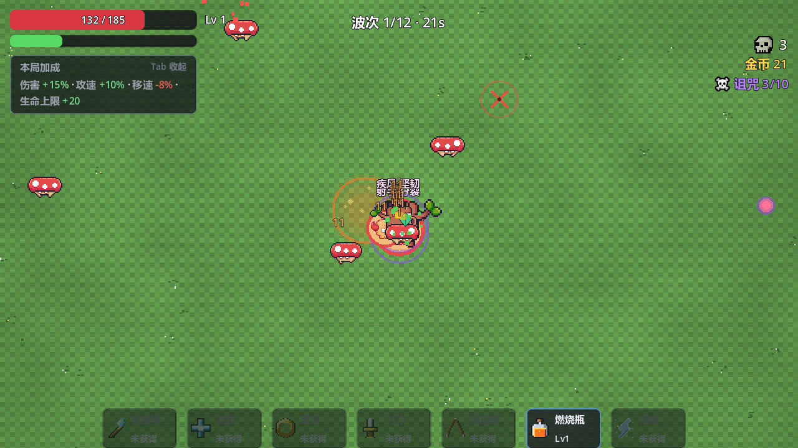 | 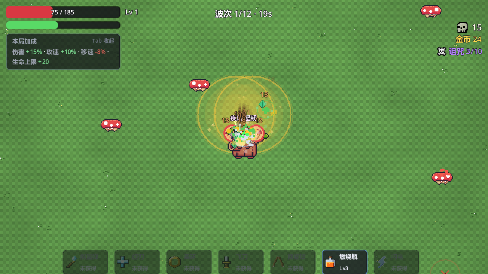 | 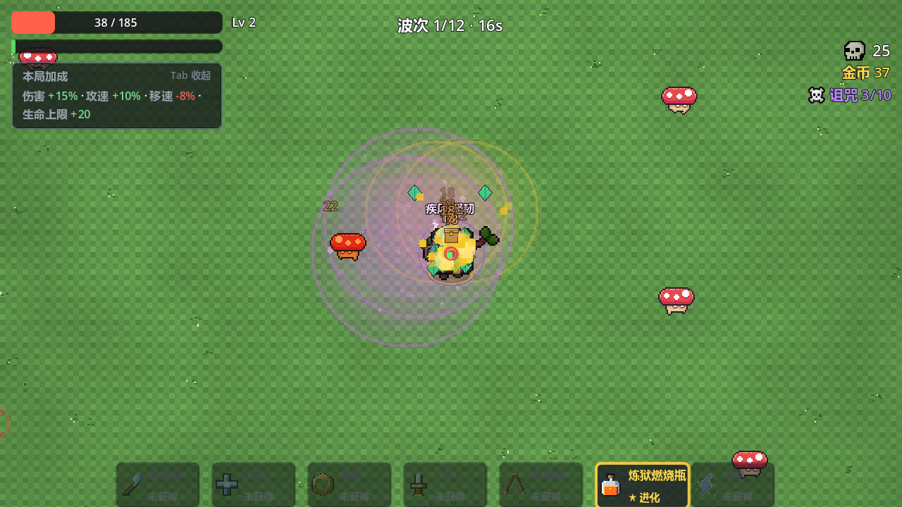 |

- 同一把武器从 Lv1(投瓶落地留火池)→ Lv3(双瓶齐投、爆炸加强)→ 进化(满级燃烧瓶 + 满级范围强化):紫色炼狱火,灼烧区更大更久更痛,右下武器槽带金色「★进化」标。
- 7 把武器各有这样一条质变链,且每把自带一条特性状态(眩晕/流血/易伤/中毒/减速/燃烧/冰冻)——手感差异的主要来源。

### 波间补给商店

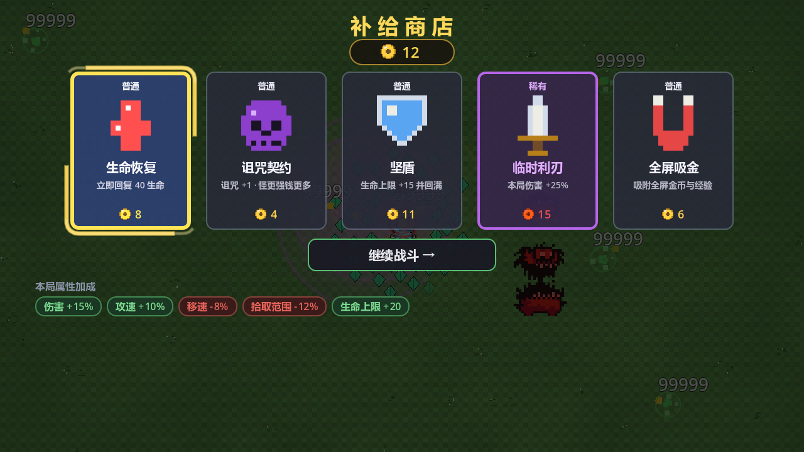

- 每波清场后花本局金币抽 5 件:恢复/坚盾/吸金是纯收益,`诅咒契约`(+1 层诅咒换更强钱袋)是风险换回报的代表,稀有度用边框配色区分。
- 底部「本局属性加成」芯片红绿分色——负面修正(移速/拾取范围)同样来自商店决策,一目了然。

### 角色选择与图鉴


- 5 名角色各带起始武器与专属被动(学徒经验/弹速、圣骑士圣盾、忍者蛙拾穗、面具客处决、只因信徒金拱)。


- 图鉴是「图书馆古籍」风双页书 + 翻页动效,5 分类(角色/武器/Boss/杂兵词缀/成就);**数值直接读实战同一份数据表**,不存在图鉴与游戏对不上的漂移。

### 通关结算

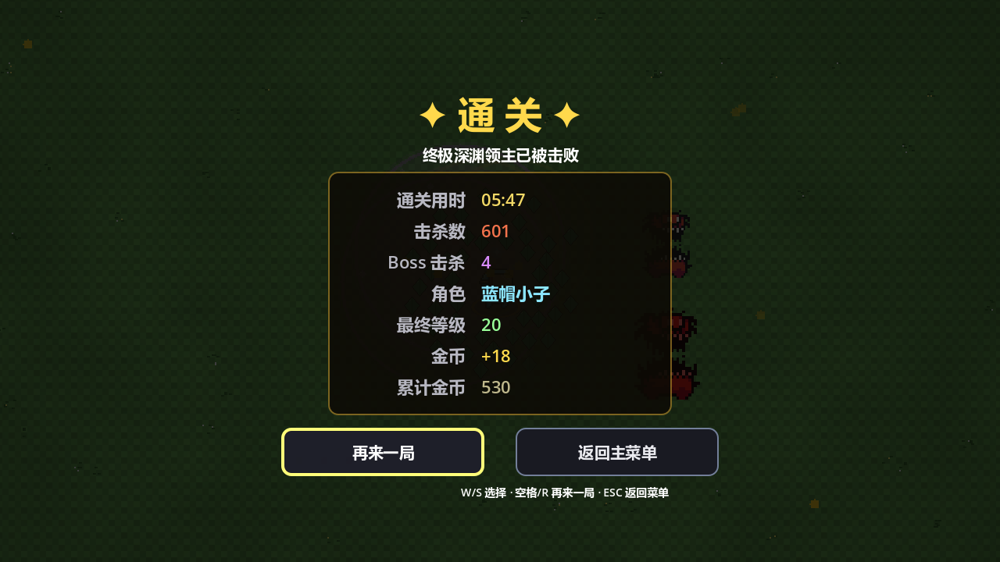

- 结算屏汇总用时/击杀/Boss 数/等级/金币;本局金币存入永久银行,回主菜单进「强化商店」买跨局强化——单局 6 分钟,局外长线养成。

### 失败结算

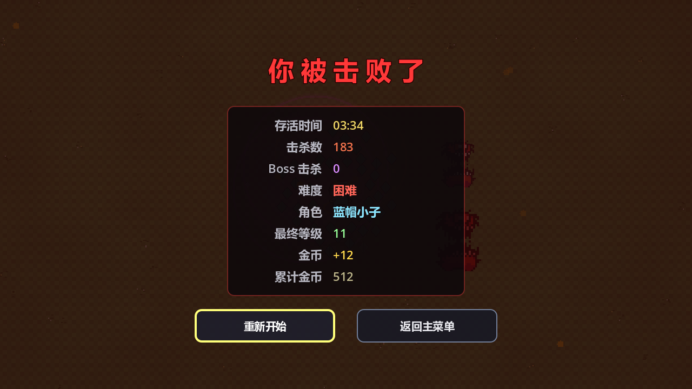

- 「你被击败了」与通关屏同构:存活时间/击杀/Boss/难度/角色/等级/本局金币——**死了金币照样入银行**,死亡不是清零,是土豆兄弟式的成长循环;`R` 一键再战。

### 局外强化商店与设置

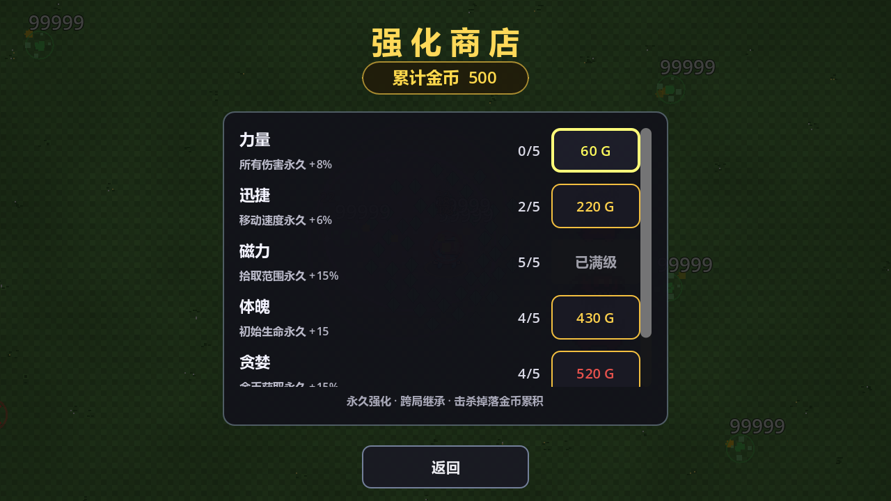

- 主菜单「强化商店」:六项永久强化各 5 级(力量/迅捷/磁力/体魄/贪婪…),花的是跨局累计金币;红色价格 = 买不起,灰色「已满级」= 拉满,进度对玩家永远可读。

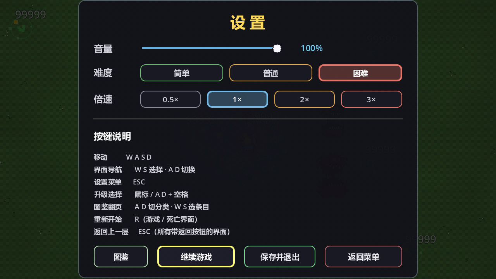

- 设置面板**就是实际的暂停菜单**(项目里没有独立 PAUSED 状态):音量/难度三档/倍速四档 + 全键位速查表;战斗中打开可「保存并退出」落续玩档,或直跳图鉴。

### 操作

`WASD`/方向键移动（自动索敌攻击）· `空格` 确认/重开 · `ESC` 设置（即暂停菜单）· `R` 重开 · `Tab` 折叠「本局加成」面板 · 升级三选一 `A`/`D` 选择 + `R` 重抽。

## 本仓库的重点：AI 开发工作流

游戏从架构、数值、美术管线到测试全部由 AI 编码代理（Claude Code + 自定义 harness）完成，人负责提需求、验收与关键拍板。质量靠三件套兜底：

**1. 项目记忆文档（[CLAUDE.md](CLAUDE.md)，57 KB）**——不是 README 的加长版，而是 AI 的「工作交接单」：每个系统的决策与理由、每条数值的实测依据、每个踩过的 GDScript 坑（`:=` 不能推断 Variant、树外控件 min-size 钳高、`Input.parse_input_event` 只入队不派发……）都记录「为什么」，任意新会话零上下文损耗续作。

**2. 可重放的验证矩阵**——没有单元测试框架，但也没有「改完靠手感」：

| 命令 | 覆盖 |
|---|---|
| `--autostart --autopilot [--autopilot-god]` | AI 自玩打穿 12 波；战报每 10s 一行，含实体/对象池一致性断言（`invalid=0`） |
| `--autopilot-style glass\|kite` | 极限承伤 / 零成长龟缩，卡难度曲线两端 |
| `--weapon-check` | 7 武器 × 常态/进化逐一真实伤害（17 项断言） |
| `--char-check` | 5 角色被动逐一接线 + 反向对照（12 项） |
| `--affix-check` | 6 词缀 + 精英双词缀逐一生效（18 项） |
| `--death-check` `--resume-check` `--overlimit-check` `--menu-check` | 死亡结算 / 存档 save→load→resume 往返 / 池空兜底 / 各界面键盘输入链 |
| `--codex-check` `--ui-shot` | 图鉴全 tab 布局走查 / 19 屏界面截图目检 |

每条专项自检对应一个**真实存在过的盲区**（例：autopilot 每局只随机 3 把武器，改坏第 7 把武器冒烟照样全绿），文档里写明盲区是什么、为什么常规测试盖不住。

**3. 测试隔离的红线设计**——带任何命令行用户参数即判定为测试跑，永久存档只读不写；判据故意做成反向的（白名单枚举漏一项的代价真实付出过）。每次改动后用 md5 比对 `user://` 存档证明零污染。

素材侧同样自动化：地图/角色精灵/怪物图集由 `map_preview/*.py`（Python + PIL）离线烘焙；武器与成就图标是内嵌 16×16 字符画数据表运行时烘焙（零素材文件）；图鉴翻页声程序合成。

## 目录结构

```
scenes/main.tscn      唯一场景：空 Node2D 挂 main.gd，其余全部代码构建
scripts/              30 个 .gd（13.6k 行）：autoload×4 / 实体 / 7 武器 / UI / 自检 harness
assets/               运行时素材：烘焙地图 / UI 图 / CC0 音频 12 轨
resource/pixel32/     精灵表运行时目录（Pixel Adventure + 0x72 二创拼接表）
resource/*.png        「只因信徒」角色原型图（自产，generate_xiaoheizi_template.py 的输入）
map_preview/          PIL 离线烘焙脚本（产物不入库）
docs/                 设计文档 + README 截图
export_presets.cfg    Godot 导出预设（exe 经 Releases 分发，不入库）
CLAUDE.md             AI 开发代理的项目记忆 —— 「怎么做到的」全文
```

## 素材授权

- 音效/BGM：[Kenney](https://kenney.nl)（impact/sci-fi/interface 三包）与 OpenGameArt haeldb 三轨，CC0
- 怪物/Boss/道具贴图：[0x72 Dungeon Tileset II](https://0x72.itch.io/dungeontileset-ii)，CC0
- 角色/史莱姆/蝙蝠/巨魔：[Pixel Adventure](https://pixelfrog-assets.itch.io/pixel-adventure-1)（免费商用；按项目需要二创拼接使用）
- 骷髅击杀图标：OpenGameArt *Pixel Art Skull*（FancySnacks），CC0
- 其余贴图（地图、武器/成就图标、特效、UI）全部程序化生成，见 `map_preview/` 与 `scripts/game_manager.gd` 字符画表
- 授权明细与来源链接：[resource/CREDITS.md](resource/CREDITS.md)

## 许可

代码与自产素材以 [MIT](LICENSE) 开源；第三方素材按其原始 CC0/免费商用授权，见上节与 [resource/CREDITS.md](resource/CREDITS.md)。
