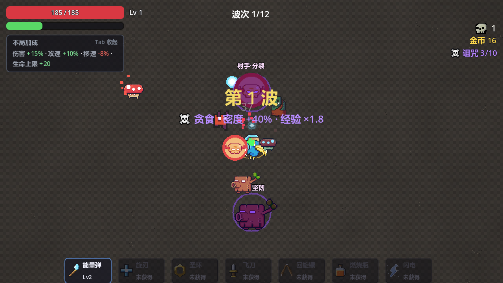
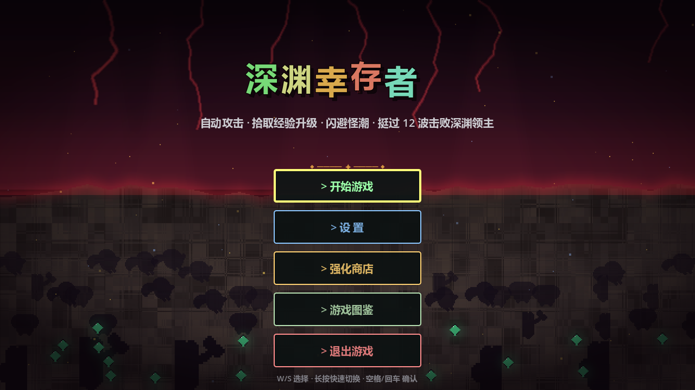
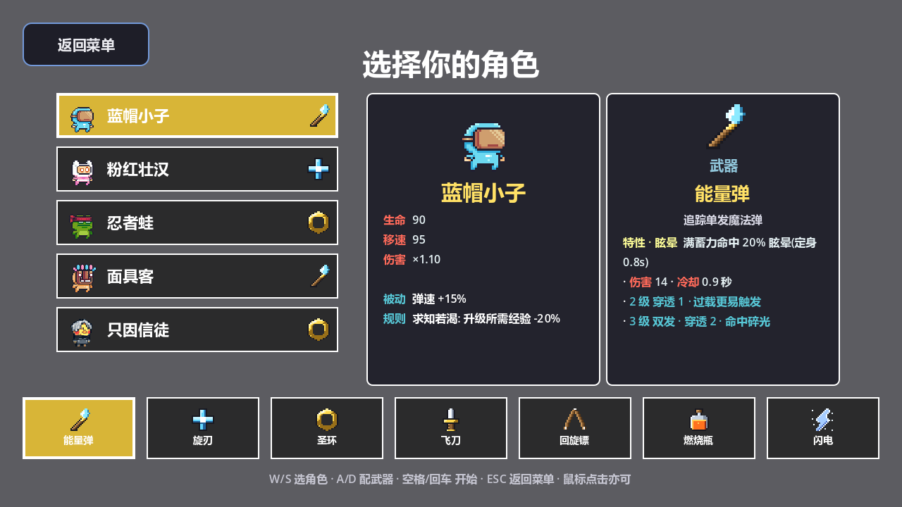
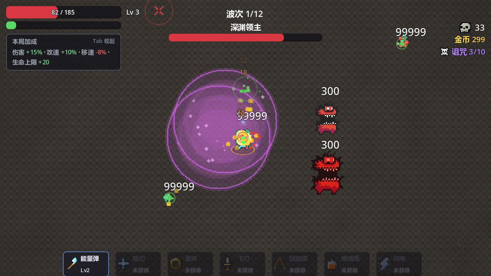
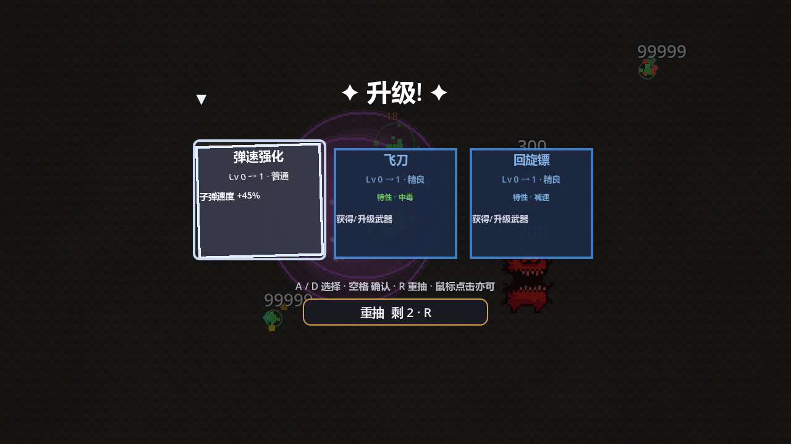
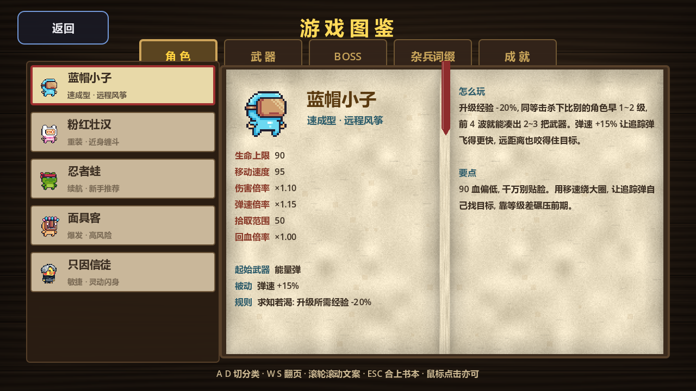

# 深渊幸存者 (Abyss Survivor)

> 一款用 AI 编码代理**全程驱动开发**的吸血鬼幸存者 Like —— Godot 4.6 / GDScript，约 1.4 万行代码，全部 UI 与素材管线代码构建（`.tscn` 只有一个挂脚本的空场景）。
> A Vampire-Survivors-like built end-to-end by an AI coding agent, with a headless self-test harness as its backbone.



## 下载即玩

- **[Releases](../../releases)** 下载 `abyss_survivor_win64_v1.0.zip`，解压双击 `abyss_survivor.exe`（Windows x64，免安装，约 100 MB）。
- 从源码运行：装 [Godot 4.6](https://godotengine.org/download)，编辑 `run.bat` 顶部的 Godot 路径后双击，或命令行 `godot --path .`。

## 游戏概览

| | |
|---|---|
| 玩法 | 俯视角割草生存，自动攻击，玩家只管走位；固定 **12 波**，一局约 6 分钟 |
| 角色 | 5 名（蓝帽小子/粉红壮汉/忍者蛙/面具客/只因信徒），各带起始武器与专属被动 |
| 武器 | 7 种（能量弹/旋刃/圣环/飞刀/手里剑/燃烧瓶/闪电）各 3 级，**7 条进化链**：满级武器 + 满级配对被动 → 质变 |
| 强化 | 9 类通用被动各 3 级 + 升级三选一（每局 2 次重抽）；常规池抽干后转「**超限**」无限成长，升级永不断档 |
| 敌人 | 7 种杂兵 + 6 种词缀（疾风/坚韧/再生/射手/分裂/自爆）+ 双词缀精英；第 4/8 波中 Boss，第 12 波双 Boss（终极 Boss 击杀即通关） |
| 风险系统 | 局内**诅咒值**（商店主动买，0–10 层）+ 8 条**波间事件**——加压与回报成对出现，绝不给玩家负面属性 |
| 难度 | 简单/普通/困难只作用敌人侧；敌人血/伤/密度随波次爬坡 |
| 养成 | 波间商店（本局金币）+ 局外军械库（永久金币）+ 11 项全局成就 |
| 存档 | 土豆兄弟式**单槽局内续玩**（关窗即存、读档即消费、原子写）+ 跨局永久进度 |
| 画面 | 640×360 逻辑分辨率整数 2× 放大到 1280×720，全局 Nearest 像素风 |
| 图鉴 | 5 分类「图书馆古籍」风图鉴（双页书翻页动效），数值与刷怪表**单一数据源** |

### 截图

| 主菜单 | 角色选择 | Boss 战 | 升级三选一 | 图鉴 |
|---|---|---|---|---|
|  |  |  |  |  |

### 操作

`WASD`/方向键移动（自动索敌攻击）· `空格` 确认/重开 · `ESC` 设置（即暂停菜单）· `R` 重开 · `Tab` 折叠「本局加成」面板 · 升级三选一 `A`/`D` 选择 + `R` 重抽。

## 本仓库的重点：AI 开发工作流

游戏从架构、数值、美术管线到测试全部由 AI 编码代理（Claude Code + 自定义 harness）完成，人负责提需求、验收与关键拍板。质量靠三件套兜底：

**1. 项目记忆文档（[CLAUDE.md](CLAUDE.md)，57 KB）**——不是 README 的加长版，而是 AI 的「工作交接单」：每个系统的决策与理由、每条数值的实测依据、每个踩过的 GDScript 坑（`:=` 不能推断 Variant、树外控件 min-size 钳高、`Input.parse_input_event` 只入队不派发……）都记录「为什么」，任意新会话零上下文损耗续作。

**2. 可重放的验证矩阵**——没有单元测试框架，但也没有「改完靠手感」：

| 命令 | 覆盖 |
|---|---|
| `--autostart --autopilot [--autopilot-god]` | AI 自玩打穿 12 波；战报每 10s 一行，含实体/对象池一致性断言（`invalid=0`） |
| `--autopilot-style glass\|kite` | 极限承伤 / 零成长龟缩，卡难度曲线两端 |
| `--weapon-check` | 7 武器 × 常态/进化逐一真实伤害（17 项断言） |
| `--char-check` | 5 角色被动逐一接线 + 反向对照（12 项） |
| `--affix-check` | 6 词缀 + 精英双词缀逐一生效（18 项） |
| `--death-check` `--resume-check` `--overlimit-check` `--menu-check` | 死亡结算 / 存档 save→load→resume 往返 / 池空兜底 / 各界面键盘输入链 |
| `--codex-check` `--ui-shot` | 图鉴全 tab 布局走查 / 19 屏界面截图目检 |

每条专项自检对应一个**真实存在过的盲区**（例：autopilot 每局只随机 3 把武器，改坏第 7 把武器冒烟照样全绿），文档里写明盲区是什么、为什么常规测试盖不住。

**3. 测试隔离的红线设计**——带任何命令行用户参数即判定为测试跑，永久存档只读不写；判据故意做成反向的（白名单枚举漏一项的代价真实付出过）。每次改动后用 md5 比对 `user://` 存档证明零污染。

素材侧同样自动化：地图/角色精灵/怪物图集由 `map_preview/*.py`（Python + PIL）离线烘焙；武器与成就图标是内嵌 16×16 字符画数据表运行时烘焙（零素材文件）；图鉴翻页声程序合成。

## 目录结构

```
scenes/main.tscn      唯一场景：空 Node2D 挂 main.gd，其余全部代码构建
scripts/              30 个 .gd（13.6k 行）：autoload×4 / 实体 / 7 武器 / UI / 自检 harness
assets/               运行时素材：烘焙地图 / UI 图 / CC0 音频 12 轨
resource/pixel32/     精灵表运行时目录（Pixel Adventure + 0x72 二创拼接表）
resource/*.png        「只因信徒」角色原型图（自产，generate_xiaoheizi_template.py 的输入）
map_preview/          PIL 离线烘焙脚本（产物不入库）
docs/                 设计文档 + README 截图
export_presets.cfg    Godot 导出预设（exe 经 Releases 分发，不入库）
CLAUDE.md             AI 开发代理的项目记忆 —— 「怎么做到的」全文
```

## 素材授权

- 音效/BGM：[Kenney](https://kenney.nl)（impact/sci-fi/interface 三包）与 OpenGameArt haeldb 三轨，CC0
- 怪物/Boss/道具贴图：[0x72 Dungeon Tileset II](https://0x72.itch.io/dungeontileset-ii)，CC0
- 角色/史莱姆/蝙蝠/巨魔：[Pixel Adventure](https://pixelfrog-assets.itch.io/pixel-adventure-1)（免费商用；按项目需要二创拼接使用）
- 骷髅击杀图标：OpenGameArt *Pixel Art Skull*（FancySnacks），CC0
- 其余贴图（地图、武器/成就图标、特效、UI）全部程序化生成，见 `map_preview/` 与 `scripts/game_manager.gd` 字符画表
- 授权明细与来源链接：[resource/CREDITS.md](resource/CREDITS.md)

## 许可

代码与自产素材以 [MIT](LICENSE) 开源；第三方素材按其原始 CC0/免费商用授权，见上节与 [resource/CREDITS.md](resource/CREDITS.md)。
